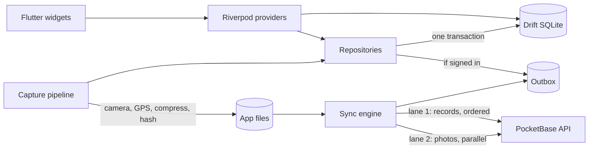

# Tickwalk

**Site inspection checklists with photo and GPS evidence that work with no signal.**


<!-- Add after build: docs/media/demo.gif and 4 screenshots (checklist, photo evidence, uploads queue, PDF report) -->

## Why this exists

Site walk-rounds often happen where signal is poor: a building under construction, a basement power room, a rural facility. Findings end up on paper, or as photos in a chat group with no link to the checklist item, no timestamp you can trust and no record of where they were taken.

Tickwalk keeps the whole inspection on the phone. Each answer is saved instantly. Each photo is compressed, stamped with time and GPS, and queued. When a connection (or Wi-Fi) is available, everything uploads in the background and you can see exactly what has been sent.

## Features

- Reusable checklist templates (starter templates included; create and edit your own)
- Pass, Fail and N/A answers, plus text and number items
- Fail rules: items can require a photo when failed
- Camera-only evidence capture with automatic time and GPS stamp (accuracy shown)
- On-device compression and thumbnails to save storage and data
- Autosave on every change; recovers if the camera kills the app
- Review screen that lists exactly what blocks completion
- Upload queue with per-photo status, retry and an optional "Wi-Fi only for photos" mode
- PDF report with failed items and photo evidence (share through any app)
- Optional account for backup and multi-device records
- Light and dark themes, large touch targets for outdoor use

## How it works

1. Every screen reads from a local SQLite database (Drift), so nothing waits on the network.
2. Starting an inspection copies the template into inspection items, so editing a template later never changes past inspections.
3. A photo goes through a pipeline: camera, GPS fix, native compression, SHA-256 hash, thumbnail, database row and a queued upload, all recorded in one transaction.
4. If you sign in, a sync engine runs two lanes: ordered record sync, then parallel photo uploads with per-file retry and backoff.

Full detail: [docs/architecture.md](docs/architecture.md).

## Evidence stamps: what they are and are not

Each photo records device time, a GPS fix with accuracy, a file hash and, once uploaded, the server's receive time. These are useful context, not proof: a device clock or GPS can be spoofed, and the app takes photos only through the camera by default to reduce misuse. The PDF report says this plainly.

## Tech stack

| Layer | Choice |
|---|---|
| App | Flutter, Dart 3 |
| State | Riverpod (`flutter_riverpod`, no code generation) |
| Local data | Drift (SQLite) |
| Navigation | go_router |
| Camera and location | image_picker (camera source), geolocator |
| Image processing | flutter_image_compress (native), crypto (SHA-256) |
| Reports | pdf, share_plus |
| Network | pocketbase, connectivity_plus |
| Secure storage | flutter_secure_storage |
| Background (P1) | workmanager |
| Backend | PocketBase with hooks, file storage |
| Errors | Sentry SDK pointed at self-hosted GlitchTip (optional) |
| Tests | flutter_test, mocktail |

Everything is free and self-hostable. No paid services, no analytics SDKs.

## Architecture



## Getting started

### Prerequisites

- Flutter SDK (stable) with Dart 3
- A phone or emulator (a real phone is best for camera and GPS testing)
- A PocketBase binary (pinned version in `backend/PB_VERSION`), only for the optional sync

### Run the app (local-only)

```bash
flutter pub get
dart run build_runner build --delete-conflicting-outputs
cp .env.example .env
flutter run
```

### Run the backend (optional)

```bash
cd backend
./pocketbase superuser create you@example.com 'choose-a-strong-password'
./pocketbase serve --http=0.0.0.0:8090
```

(On older PocketBase versions the command is `admin create`.) Set `API_URL` in `.env`:

| Device | URL |
|---|---|
| Android emulator | `http://10.0.2.2:8090` |
| Phone on the same Wi-Fi | `http://<your-computer-LAN-IP>:8090` |
| Phone over USB (after `adb reverse tcp:8090 tcp:8090`) | `http://localhost:8090` |

Use HTTPS beyond local demos.

### Commands

| Command | Purpose |
|---|---|
| `flutter run` | Run the app |
| `flutter test` | Run unit and widget tests |
| `flutter analyze` | Static analysis |
| `dart run build_runner build --delete-conflicting-outputs` | Generate Drift code |
| `flutter build apk --release --split-per-abi` | Release build for measuring size |

Measure performance in profile or release mode only.

## Project structure

```text
tickwalk/
  lib/
    main.dart, app.dart
    core/            clock, ids, logger, result, errors, dates
    domain/          models, template_schema, validation, report_model
    data/
      db/            Drift database, tables, DAOs
      repositories/  templates, inspections, items, attachments, settings, outbox
      sync/          outbox, engine, record_lane, media_lane, backoff, merge
      api/           pocketbase client, auth, error mapper
    capture/         capture_pipeline, gps, compression_profiles, recovery
    reports/         pdf_builder
    features/        inspections, checklist, templates, uploads, settings, onboarding, account
    ui/              theme tokens, shared widgets
  test/
  backend/           pb_hooks, pb_migrations
  docs/              design, story, demo, prd, cursorcontext, architecture
```

## Testing

`flutter test` covers template parsing, completion validation, summary recompute, compression profile math, the upload scheduler (concurrency, backoff, Wi-Fi gating, parent-first ordering), outbox coalescing, capture recovery logic, report assembly, and the sync engine against a fake server with injected failures. The manual matrix is in [docs/architecture.md](docs/architecture.md#14-testing-strategy).

## Known limitations

- Single user per account; sharing is by PDF
- Photos from another device show a placeholder until downloaded on demand (roadmap)
- Uploads restart a file from the beginning after an interruption (files are small; chunked resumable upload is a later project)
- Stamps are not tamper-proof
- The local database and photos are not encrypted at rest
- Last-write-wins sync per record
- iOS background uploads are best effort

## Roadmap

- Team workspaces and reviewer roles
- On-demand photo download on other devices
- Resumable chunked uploads
- Offline map view of findings
- Encryption at rest
- Backend move to Go or Python with Postgres using the same protocol

## Documentation

| Doc | Contents |
|---|---|
| [prd.md](docs/prd.md) | Problem, scope, user stories, acceptance criteria |
| [design.md](docs/design.md) | UI/UX, tokens, screens, patterns replicated |
| [architecture.md](docs/architecture.md) | Data model, capture pipeline, upload queue, sync, reports |
| [story.md](docs/story.md) | The narrative and interview talking points |
| [demo.md](docs/demo.md) | Demo script and recording guide |
| [cursorcontext.md](docs/cursorcontext.md) | Instructions for the AI coding agent |

## License

MIT