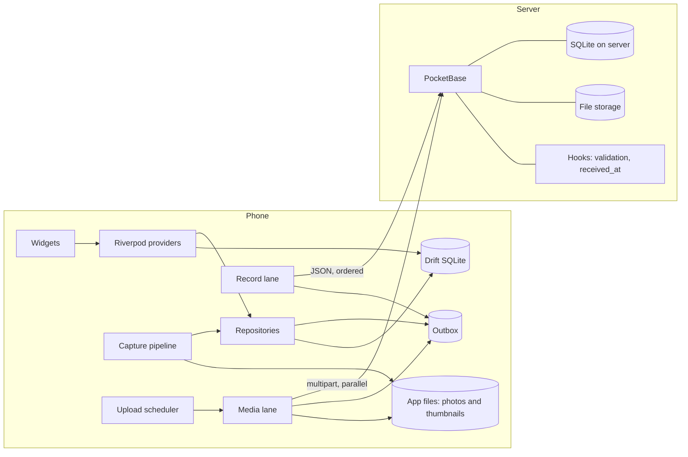
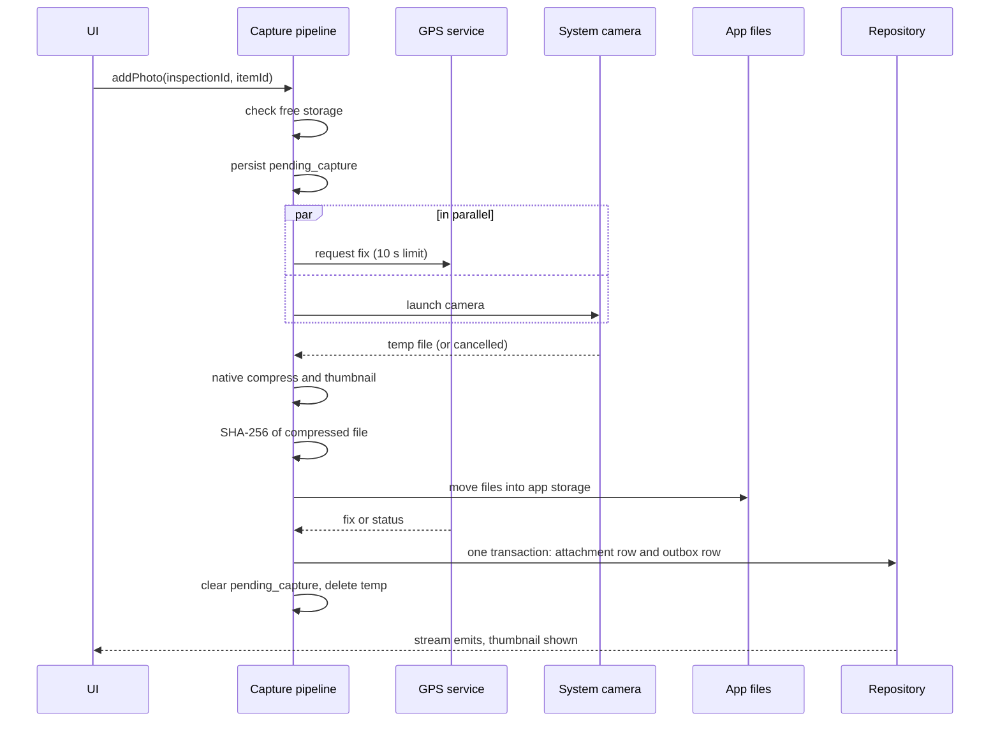

# Tickwalk: Architecture

## 1. Overview and principles

Tickwalk is local-first. The device database and app storage are the source of truth for inspections and photos. The server is an optional backup and multi-device target.

| Principle | Where it lives |
|---|---|
| Offline-first, local DB as source of truth | `lib/data/db`, all reads through Drift streams |
| Snapshot, not reference | `inspection_items` copy the template at start |
| Cached derived data kept consistent | Inspection counts recomputed in the same transaction |
| Robust media pipeline | `lib/capture` (camera, GPS, compress, hash, recover) |
| Queue-and-retry with two lanes | `data/sync/record_lane.dart`, `media_lane.dart` |
| Idempotency | Client IDs, multipart create with a client ID, duplicate-as-success |
| Data awareness | Compression profiles, Wi-Fi gating, upload estimates |
| Graceful degradation | Works with no network, no account, no GPS permission |
| Error handling and resilience | Error taxonomy, parked ops with plain reasons, recovery |
| Secure storage and privacy | Secure storage for tokens, EXIF stripped, protected server files |
| Observability | Logger interface with optional GlitchTip |

## 2. System context



## 3. Client architecture

Layers: **features** (widgets and providers), **domain** (pure Dart), **data** (repositories, Drift, sync, API), **capture** and **reports** (platform and I/O glue). Dependencies point inward.

State separation:
- Persistent data: Drift tables as streams; files in the app documents directory
- UI-only state: Riverpod notifiers (expanded sections, selected tab, one-batch "upload now" flag)
- Derived: per-inspection upload status from outbox and attachment rows
- Sync status: connectivity, engine state, outbox counts, sign-in state

Providers (manual): `databaseProvider`, `clockProvider`, `settingsProvider`, `templatesStreamProvider`, `inspectionsStreamProvider(status)`, `inspectionItemsProvider(id)`, `attachmentsForItemProvider(itemId)`, `uploadQueueProvider`, `syncStatusProvider`.

## 4. Local data model

Timestamps are integer milliseconds since epoch. Coordinates are REAL degrees.

```sql
CREATE TABLE templates (
  id TEXT PRIMARY KEY,
  name TEXT NOT NULL,
  description TEXT,
  structure TEXT NOT NULL,                  -- JSON, schemaVersion 1 (section 5)
  is_starter INTEGER NOT NULL DEFAULT 0,
  created_at INTEGER NOT NULL,
  updated_at INTEGER NOT NULL,
  deleted_at INTEGER
);

CREATE TABLE inspections (
  id TEXT PRIMARY KEY,
  template_id TEXT,
  template_name TEXT NOT NULL,              -- snapshot
  site_name TEXT NOT NULL,
  site_address TEXT,
  inspector_name TEXT NOT NULL,
  status TEXT NOT NULL CHECK (status IN ('in_progress','completed')),
  started_at INTEGER NOT NULL,
  completed_at INTEGER,
  reopened_count INTEGER NOT NULL DEFAULT 0,
  start_lat REAL, start_lng REAL, start_accuracy_m REAL,
  start_gps_status TEXT,                    -- fix | stale | none | denied
  start_gps_at INTEGER,
  signature_attachment_id TEXT,
  notes TEXT,
  -- cached counts (recomputed in the same transaction as item changes)
  total_items INTEGER NOT NULL DEFAULT 0,
  answered_items INTEGER NOT NULL DEFAULT 0,
  pass_count INTEGER NOT NULL DEFAULT 0,
  fail_count INTEGER NOT NULL DEFAULT 0,
  na_count INTEGER NOT NULL DEFAULT 0,
  created_at INTEGER NOT NULL,
  updated_at INTEGER NOT NULL,
  deleted_at INTEGER
);
CREATE INDEX idx_insp_status ON inspections(deleted_at, status, started_at DESC);

CREATE TABLE inspection_items (
  id TEXT PRIMARY KEY,
  inspection_id TEXT NOT NULL REFERENCES inspections(id),
  section_title TEXT NOT NULL,              -- snapshot
  section_order INTEGER NOT NULL,
  item_order INTEGER NOT NULL,
  prompt TEXT NOT NULL,                     -- snapshot
  item_type TEXT NOT NULL CHECK (item_type IN ('pass_fail','text','number')),
  unit TEXT,
  required INTEGER NOT NULL DEFAULT 0,
  photo_required_on_fail INTEGER NOT NULL DEFAULT 0,
  response TEXT CHECK (response IN ('pass','fail','na')),
  severity TEXT CHECK (severity IN ('low','medium','high')),
  text_value TEXT,
  number_value REAL,
  note TEXT,
  responded_at INTEGER,
  created_at INTEGER NOT NULL,
  updated_at INTEGER NOT NULL
);
CREATE INDEX idx_items_insp ON inspection_items(inspection_id, section_order, item_order);

CREATE TABLE attachments (
  id TEXT PRIMARY KEY,
  inspection_id TEXT NOT NULL REFERENCES inspections(id),
  item_id TEXT REFERENCES inspection_items(id),   -- null for signature
  kind TEXT NOT NULL CHECK (kind IN ('photo','signature')),
  local_path TEXT,                          -- null if pulled from another device
  thumb_path TEXT,
  sha256 TEXT NOT NULL,
  bytes INTEGER NOT NULL,
  width INTEGER, height INTEGER,
  compression_profile TEXT,                 -- low | standard | high | original
  captured_at INTEGER NOT NULL,
  gps_lat REAL, gps_lng REAL, gps_accuracy_m REAL,
  gps_status TEXT NOT NULL,                 -- fix | stale | none | denied
  gps_at INTEGER,
  caption TEXT,
  uploaded_at INTEGER,                      -- set when the server accepted the file
  server_received_at INTEGER,               -- from the server
  created_at INTEGER NOT NULL,
  updated_at INTEGER NOT NULL,
  deleted_at INTEGER
);
CREATE INDEX idx_att_item ON attachments(item_id, deleted_at);

CREATE TABLE settings (
  key TEXT PRIMARY KEY,   -- inspector_name, theme, quality_profile, wifi_only, allow_gallery,
                          -- pending_capture, sync_owner_id
  value TEXT NOT NULL
);

CREATE TABLE outbox (
  seq INTEGER PRIMARY KEY AUTOINCREMENT,
  entity TEXT NOT NULL CHECK (entity IN ('template','inspection','inspection_item','attachment')),
  entity_id TEXT NOT NULL,
  op TEXT NOT NULL CHECK (op IN ('create','update','delete')),
  payload TEXT NOT NULL,
  lane TEXT NOT NULL CHECK (lane IN ('records','media')),
  attempts INTEGER NOT NULL DEFAULT 0,
  next_attempt_at INTEGER NOT NULL DEFAULT 0,
  status TEXT NOT NULL DEFAULT 'pending' CHECK (status IN ('pending','parked')),
  last_error TEXT,                          -- error class and plain reason key, never user content
  created_at INTEGER NOT NULL
);

CREATE TABLE sync_state (
  key TEXT PRIMARY KEY,
  value TEXT NOT NULL
);
```

Notes:
- Foreign keys on; WAL mode; migrations generated by Drift's tooling.
- `lane` is `media` only for attachment creates. Attachment updates and deletes use the `records` lane.
- Site data is denormalized onto inspections; "recent sites" is a distinct query over past inspections.
- The outbox is only written when signed in; first sign-in enqueues existing data (section 8.6).

## 5. Templates and snapshots

### 5.1 Template JSON (schemaVersion 1)

```json
{
  "schemaVersion": 1,
  "sections": [
    {
      "id": "s1",
      "title": "Access and housekeeping",
      "items": [
        {
          "id": "i1",
          "prompt": "Walkways and access routes are clear",
          "type": "pass_fail",
          "required": true,
          "photoRequiredOnFail": true,
          "unit": null
        }
      ]
    }
  ]
}
```

Validation: at least one section, at least one item, prompts 1 to 200 chars, unique IDs, supported `type`, unit only for `number`. Unknown `schemaVersion` is a typed error, never a crash.

### 5.2 Starting an inspection

In one transaction: insert the inspection (with `template_name` snapshot), insert one `inspection_item` per template item with section and item order, set `total_items`, and enqueue outbox rows if signed in. After this point nothing reads the template for that inspection.

### 5.3 Cached counts

`recomputeSummary(inspectionId)` recomputes `answered_items`, `pass_count`, `fail_count`, `na_count` from `inspection_items` inside the same transaction as any answer change. A test runs random answer sequences and asserts the cache equals a brute-force recompute.

### 5.4 Completion validation (pure)

`validateCompletion(items, photoCountByItem)` returns blockers:
- `UnansweredRequired(itemId)` for required items not answered
- `MissingPhoto(itemId)` for pass_fail items with `fail`, `photo_required_on_fail`, and zero photos

Complete is allowed only when the list is empty. Completing sets `status = completed` and `completed_at`; repositories reject item and attachment writes on completed inspections until reopened.

## 6. Capture pipeline

### 6.1 Steps



### 6.2 Compression profiles

| Profile | Longest edge | Quality | Use |
|---|---|---|---|
| Low data | 1280 px | 65 | Slow or expensive connections |
| Standard | 1600 px | 75 | Default |
| High | 2048 px | 85 | Detail-critical findings |
| Thumbnail | 320 px | 70 | Lists and strips |

EXIF is stripped from stored files. Measure average output size per profile and record it in `story.md`. Verify the compression library's resize semantics with a test image.

### 6.3 GPS

- One-shot fix, not continuous tracking; high accuracy, 10 s limit
- Accept the first fix with accuracy at or below 50 m; otherwise the best fix at the limit
- No fix: use last known position marked `stale`; none: `none`; permission denied: `denied`
- Capture never blocks on GPS beyond the limit and never fails because of it
- Permission requested contextually at first inspection start, "when in use" only

### 6.4 Interruption recovery

Android can destroy the app while the camera is in the foreground. Before launching the camera, store `pending_capture = {inspectionId, itemId, startedAt}`. On app start and resume, ask the picker for lost data (verify the API in the installed `image_picker`). If a file is returned and a pending capture exists and is recent (within 30 minutes), run the pipeline for it; otherwise discard the file. Clear `pending_capture` after any resolution.

### 6.5 Failure handling

| Failure | Behavior |
|---|---|
| Camera cancelled | Clear pending capture; nothing else |
| Low storage | Message "Not enough space to save the photo"; no capture |
| Compression fails | Keep the original, set profile `original`, continue; the PDF step downscales |
| Hash or file move fails | Roll back, delete partial files, show a retry message |
| Database transaction fails | Delete the moved files so no orphans remain |
| Process killed after files moved but before the row | On next start, an orphan sweeper matches files with no row and removes them (or re-attaches via pending capture) |

### 6.6 Storage layout

```text
<app documents>/inspections/<inspectionId>/<attachmentId>.jpg
<app documents>/inspections/<inspectionId>/<attachmentId>_t.jpg
```

Files live in app-private storage (not the shared gallery). Consider disabling platform auto-backup of this folder for privacy (decision recorded in `adr.md`).

## 7. Evidence model and honesty

Each photo stores device time, GPS fix with accuracy and status, file hash, size and, after upload, `server_received_at`. These are contextual evidence only. Device clocks and GPS can be spoofed. Mitigations: camera-only capture by default, hash recorded at capture, server receive time as a second timestamp, and the PDF report states these limits. The server checks the uploaded file size against `bytes` and, if the pinned PocketBase hook environment allows hashing, the SHA-256 against `sha256` (verify; otherwise size only).

## 8. Sync (optional, only when signed in)

### 8.1 Account model

- Not signed in: no outbox rows, no network calls
- Signed in: every write also inserts an outbox row in the same transaction
- `sync_owner_id` ties local data to an account; signing in as a different user prompts: replace local data or cancel

### 8.2 Two lanes

| Lane | Contents | Ordering | Failure behavior |
|---|---|---|---|
| Records | Templates, inspections, items, attachment updates and deletes (JSON) | Strict by `seq`, parents first | Stop on retryable error; park permanent errors |
| Media | Attachment creates (multipart upload) | Independent; starts only after the parent inspection and item are synced | Per-op backoff; failures do not block others |

### 8.3 Coalescing (records lane)

| Sequence | Result |
|---|---|
| create then updates | One create with final state |
| updates then updates | One update with latest values |
| create then delete (never synced) | Both dropped (and any queued upload for a deleted attachment is cancelled) |
| updates then delete | One delete |

Rapid answer changes on the same item collapse to one update.

### 8.4 Upload scheduler (pure)

```text
nextUploads(queue, now, inFlight, concurrency = 2, wifiOnly, connection, oneBatchOverride)
```

Returns attachment ops that are ready: pending, `next_attempt_at <= now`, parents synced, local file present, and permitted by connectivity (Wi-Fi only blocks mobile data unless the one-batch override is on). Waiting reasons are returned for the UI (`waitingForWifi`, `offline`, `waitingForParent`, `backoff`).

### 8.5 Upload execution

1. Read the file from `local_path` (park with `fileMissing` if absent)
2. Multipart create with the client attachment ID and metadata fields; timeout 60 s
3. Success: set `uploaded_at` and `server_received_at`, delete the outbox row
4. Duplicate create (record exists): GET the record, treat as success
5. Errors per section 10; backoff base 5 s, factor 2, jitter plus or minus 20%, cap 15 minutes
6. Cancel in-flight uploads when the connection becomes metered and Wi-Fi only is on; the op returns to waiting without counting an attempt

Whole-file retry; no chunking (files are small). Progress is shown as per-file state, not a percentage.

### 8.6 First sign-in

Enqueue records for all non-deleted local data except nothing needs seeding (starter templates sync as normal templates); enqueue media creates for attachments with `uploaded_at` null. Push records, then media, then pull.

### 8.7 Pull and merge

- Cursor per collection in `sync_state`; `updated >= cursor`, sorted `updated,id`, 200 per page
- Apply each page in one transaction, skipping entities with pending outbox ops; apply tombstones
- After applying items, recompute affected inspection counts
- Pulled attachments have `local_path = null`; the UI shows a placeholder (on-demand download is future work)
- Triggers: app resume, connectivity regained, after a drain, background task, manual refresh

### 8.8 Conflicts

Single LWW timestamp per record. The server clamps timestamps more than 5 minutes ahead and returns 409 `stale_write` for older JSON writes; the client applies the server record. Clock skew can lose ties (documented limitation).

### 8.9 Status model

Per attachment: `waiting` (with reason), `uploading`, `uploaded`, `retrying`, `failed` (with reason key). Per inspection: derived from its attachments and outbox rows ("3 photos waiting", "Uploaded"). Global: banner on the Uploads tab.

### 8.10 Background upload (P1)

A `workmanager` one-off or periodic task opens its own database connection, runs the upload scheduler for a bounded time and exits. Android: network-connected constraint (unmetered when Wi-Fi only). iOS is best effort. The foreground app always uploads when open.

## 9. Backend (PocketBase)

Pin the version in `backend/PB_VERSION` and read that version's docs before writing hooks. Verify field, rule, file and hook details, especially multipart create with a client-supplied ID.

### 9.1 Collections

All collections carry `owner` (relation to `users`), `client_updated_at` (number) and optional `deleted_at` (number). PocketBase `updated` is the pull cursor.

| Collection | Fields |
|---|---|
| `templates` | `name`, `description`, `structure` (JSON), `is_starter` |
| `inspections` | `template_id`, `template_name`, `site_name`, `site_address`, `inspector_name`, `status`, `started_at`, `completed_at`, `reopened_count`, `start_lat`, `start_lng`, `start_accuracy_m`, `start_gps_status`, `start_gps_at`, `signature_attachment_id`, `notes`, cached counts |
| `inspection_items` | `inspection` (text id), `section_title`, `section_order`, `item_order`, `prompt`, `item_type`, `unit`, `required`, `photo_required_on_fail`, `response`, `severity`, `text_value`, `number_value`, `note`, `responded_at` |
| `attachments` | `inspection` (text id), `item` (text id, optional), `kind`, `file` (file, single, max about 3 MB, image types only, **protected**), `sha256`, `bytes`, `width`, `height`, `compression_profile`, `captured_at`, `gps_lat`, `gps_lng`, `gps_accuracy_m`, `gps_status`, `gps_at`, `caption`, `received_at` (set by the server) |

### 9.2 API rules (starting point; test in the Admin UI rule tester)

| Operation | Rule |
|---|---|
| List and view | `@request.auth.id != "" && owner = @request.auth.id` |
| Create | `@request.auth.id != "" && @request.body.owner = @request.auth.id` |
| Update | `@request.auth.id != "" && owner = @request.auth.id && @request.body.owner:isset = false` |
| Delete | none (soft delete only) |

Protected files require a short-lived file token to read (verify how it works in the pinned version).

### 9.3 Hooks

- Validate: text lengths, `status` and enum values, coordinate ranges, `bytes` equals the uploaded file size, image MIME types only, size cap
- On attachment create: set `received_at` to server time (the client cannot set it)
- Conflict guard on JSON updates: clamp `client_updated_at` to server now if more than 5 minutes ahead; if older than the stored value, respond 409 `stale_write` with the current record
- Duplicate create (same client ID) returns the existing-record error that the client treats as success after a GET (verify)
- If the pinned hook environment allows, compare the uploaded file's SHA-256 with `sha256`

### 9.4 Operations

Run locally with `./pocketbase serve --http=0.0.0.0:8090`, commit `pb_migrations`, use PocketBase backups (they include uploaded files; plan disk space), HTTPS beyond local demos.

## 10. Error handling

| Class | Examples | Retry | User sees | Log |
|---|---|---|---|---|
| network | timeout, no connection | Yes, backoff | Uploads: Offline or Retrying soon | breadcrumb |
| transient | 5xx, 429 (respect Retry-After) | Yes, backoff | Retrying soon | warn |
| auth | 401 | Refresh once, then park and prompt | Banner: "Sign in again to resume backup" | info |
| forbidden | 403 | No, park | Failed with plain reason | error |
| validation | 400, 422 | No, park | Failed with plain reason | error (ids only) |
| tooLarge | 413 | No, park | "File too large" | error |
| conflict | 409 `stale_write` | Resolved by applying server record | Nothing | info |
| notFound | 404 on delete | Treated as success | Nothing | debug |
| fileMissing | local file absent | No, park | "File missing on this phone" | error |
| storageFull | no space at capture | No | "Not enough space to save the photo" | warn |
| permission | location or camera denied | No | Contextual message; app keeps working | info |
| local | database failure | No | Recovery screen with Restart | error |
| unknown | uncaught exceptions | n/a | Global handler and route fallback | error |

Rules: never show raw exception text; never log notes, captions, site names, coordinates, paths or emails; never delete local photos or data because of network or auth errors.

## 11. Performance plan

| Concern | Approach |
|---|---|
| Capture | Native compression off the main thread; one image processed at a time; no full-resolution decode in Dart; thumbnails for all lists |
| Checklist | Builder-based slivers, stable keys, per-item providers, `select` to limit rebuilds, only visible photo strips load thumbnails with `cacheWidth` |
| Writes | One transaction per user action; coalesced outbox |
| Uploads | Max 2 concurrent, bounded memory (stream file reads where supported), cancellable |
| PDF | Built in an isolate; photos downscaled to about 900 px; cap 4 photos per failed item |
| Startup | Only database and theme before the first frame; defer GPS warm-up, sync boot, orphan sweep and recovery check until after it |
| Measurement | Profile mode on a low-end phone with a 60-item, 40-photo inspection; DevTools frame timings; capture-to-thumbnail time logged in dev builds; cold start via `adb shell am start -W` on a release build; APK size from `--split-per-abi` |

Budgets: thumbnail visible within 1.5 s, interaction under 100 ms, under 1% frames over budget, cold start under 2 s, APK per ABI under 30 MB, Standard profile photos under 500 KB average.

## 12. Security and privacy

- Token in `flutter_secure_storage`; never logged
- Photos and metadata are app-private; EXIF stripped so shared files do not leak location
- No analytics SDKs; location used only at capture and inspection start
- Owner-scoped API rules and protected file access; verified by a manual cross-account test
- HTTPS beyond local demos
- Account guard prevents merging two people's data on one phone
- Local database and photos are not encrypted at rest (documented limitation)
- Photos can contain people or sensitive details; the demo uses harmless subjects, and the README tells users to follow their own policies
- No secrets in the repo; `.env` carries only the API URL and an optional error DSN

## 13. Observability

- `Logger` interface with console and optional Sentry (GlitchTip DSN) implementations
- Breadcrumbs for capture (stage timings), upload attempts (state, error class) and recovery events with ids and counts only
- Uploads tab doubles as the in-app diagnostic view
- PocketBase admin logs for server-side issues

## 14. Testing strategy

**Domain (flutter_test):** template schema, completion validation, compression profile calculations, upload scheduler (concurrency, backoff, gating, parent-first, waiting reasons), backoff, outbox coalescing, report model, recovery decision logic.

**Data:** in-memory Drift tests for snapshot behavior, summary consistency, read-only after completion, and orphan sweep.

**Sync:** engine against a fake server with injected failures: timeout mid-upload, 500, 429, 401, 409, 413, duplicate create, crash between server success and outbox delete, missing local file.

**Widget:** answering items, fail panel with required photo, review blockers, uploads tab states.

**Manual matrix:**

| # | Scenario | Expected |
|---|---|---|
| 1 | Airplane mode: complete a 20-item inspection with 15 photos | All saved; thumbnails fast; counts correct |
| 2 | Reconnect on Wi-Fi | All 15 photos upload; server shows 15 records, none duplicated |
| 3 | Kill the app while the camera is open | Photo recovered and attached to the right item |
| 4 | Kill the app mid-upload | Resumes (whole file); one server record per photo |
| 5 | Wi-Fi only on, mobile data only | Photos wait with a clear reason; Upload now sends one batch |
| 6 | Deny location | Photos saved with "No GPS (permission off)"; nothing breaks |
| 7 | Indoors with no fix | Stale or none status within 10 s; capture still works |
| 8 | Edit a template after starting an inspection | Inspection unchanged |
| 9 | Try to complete with a missing required photo | Blocker shown; Complete disabled |
| 10 | Edit a completed inspection | Rejected until Reopen |
| 11 | Storage nearly full | Clear message; no partial files left |
| 12 | Delete a file from storage manually, then upload | Op parked as file missing; UI explains |
| 13 | Sign in as a different account on a used phone | Replace-or-cancel prompt |
| 14 | Cross-account API and file access | Rejected |
| 15 | 60-item checklist with 40 photos | Smooth scroll in profile mode |
| 16 | Generate PDF with many failed items | Completes without crash; photos downscaled |
| 17 | Change the device clock | Stamps reflect device time; server `received_at` differs, shown in metadata |

## 15. Architecture decision records

| ADR | Decision | Alternatives | Why |
|---|---|---|---|
| 1 | Drift for local data | sqflite, Isar | Typed queries, streams, SQL control |
| 2 | Template stored as a JSON document | Normalized tables | One editable unit, simple sync, schema version |
| 3 | Snapshot template into inspection items | Reference the template | History must not change |
| 4 | `image_picker` camera source | Custom `camera` UI | Far less code, camera-only default; recovery handled explicitly |
| 5 | Native compression, EXIF stripped, metadata in DB | Dart image processing, keep EXIF | Fast on low-end phones; avoids leaking location |
| 6 | Two sync lanes | Single ordered queue | Records need order; photos are large and independent |
| 7 | Client attachment ID as server record ID | Server-generated IDs | Idempotent multipart retries |
| 8 | Whole-file retry | Chunked resumable upload | Small files; chunking is a later project |
| 9 | Wi-Fi only option with one-batch override | Always upload | Data costs; user control |
| 10 | Server `received_at` and file hash | Client stamps only | Second timestamp the device cannot set |
| 11 | Denormalized site fields | Sites table | Simpler; recent sites derive from history |
| 12 | LWW per record | CRDTs | Single-user data, low conflict risk |
| 13 | Optional account | Mandatory signup | Time-to-value and privacy |

## 16. Scaling limits and upgrade path

PocketBase is a single node with SQLite and local file storage: fine for personal use at portfolio scale. To scale, reimplement the record and media protocols in Go or Python on Postgres with object storage (MinIO) and resumable uploads, add workspace ownership for teams, and keep the client's repositories, outbox and capture pipeline unchanged.

## 17. Open questions

- Does the pinned PocketBase accept multipart create with a client-supplied record ID, and what does it return for duplicates?
- Can PocketBase hooks hash uploaded files, or is size-only verification the limit?
- Does `image_picker` lost-data retrieval behave reliably on the target test phone?
- Compression library resize semantics (minimum versus maximum dimensions) in the installed version
- Does the in-memory Drift database run under `flutter test` on the host machine without extra setup?
- Should Android auto-backup be disabled for the photo folder?
- Does `workmanager` constraint handling (unmetered) work as expected on the target phone?

## Appendix A. Starter templates (samples, not regulatory checklists)

Adapt these to your own standards. Include a line in the UI: "Sample template. Adapt to your own standards."

**1. Site safety walk (construction sample)**

| Section | Items (type) |
|---|---|
| Access and housekeeping | Walkways and access routes are clear (pass/fail, required, photo on fail); Materials are stacked and stored safely (pass/fail, photo on fail); Warning signs and notices are visible (pass/fail) |
| People and PPE | Workers are wearing helmets (pass/fail, photo on fail); Workers are wearing safety footwear (pass/fail); First aid kit is available and stocked (pass/fail, required); Number of workers on site (number, unit: people) |
| Equipment and power | Scaffolding and ladders look stable (pass/fail, photo on fail); Cables are protected and not across walkways (pass/fail, photo on fail); Fire extinguisher is accessible (pass/fail, required); Generator is ventilated and away from flammables (pass/fail, photo on fail) |
| Notes | Other observations (text) |

**2. Rental property move-in check**

| Section | Items (type) |
|---|---|
| Entrance and doors | Doors close and lock properly (pass/fail, photo on fail); Number of keys handed over (number, unit: keys) |
| Living areas | Walls and ceiling are free of damage (pass/fail, photo on fail); Windows open, close and latch (pass/fail); Floors are free of damage (pass/fail, photo on fail) |
| Kitchen and bathroom | Sink drains and taps run (pass/fail, photo on fail); Cupboards and fittings are intact (pass/fail); Toilet flushes and does not leak (pass/fail, photo on fail); Shower and taps work (pass/fail) |
| Power and water | Sockets and switches work (pass/fail); Meter number (text); Meter reading (number, unit: kWh); Water supply is working (pass/fail) |

**3. Generator and power room check**

| Section | Items (type) |
|---|---|
| Daily checks | Fuel level (number, unit: litres); Oil level looks correct (pass/fail, required); No visible fuel or oil leaks (pass/fail, photo on fail); Exhaust vents outdoors (pass/fail, required); Area is clear of flammable items (pass/fail, photo on fail); Fire extinguisher present and accessible (pass/fail, required); Unusual noise or vibration (pass/fail) |
| Records | Runtime hours (number, unit: hours); Last service date (text); Notes (text) |